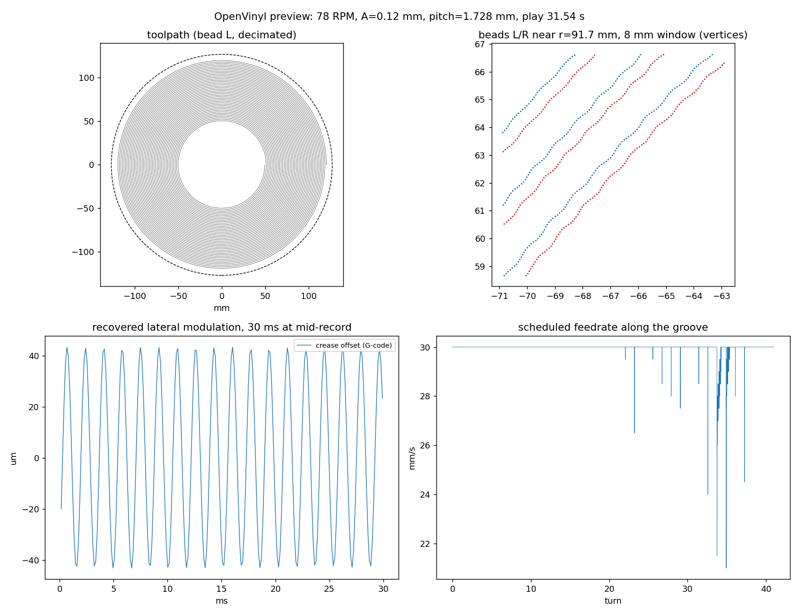

# OpenVinyl

Playable records printed on a hobby FDM printer, and a printed turntable to play them.

The encoder turns a WAV file into the printer's own G-code. The groove is two beads laid side by side that wiggle together, and the stylus rides the crease between them. No slicer touches the groove: the tool writes every move itself, so a 0.48 mm bead is placed to about 0.01 mm, and every groove parameter follows from the bead width, the printer's acceleration and what the stylus was measured to follow.



What it does today: a 7 inch disc at 40 RPM holds about 32 seconds of mono music, printed on a Bambu Lab P1S in about 70 minutes, and played start to finish on the printed turntable with a ceramic cartridge recorded by an Arduino. It is a working record, not a good one: the band is roughly 120 Hz to 500-850 Hz, and the surface noise is high.

## What's here

| Path | What |
|:--|:--|
| `src/openvinyl/` | The encoder: audio conditioning, groove geometry, G-code emission, splicing onto a sliced blank disc, a decoder that turns the G-code back into audio, and the playback cleanup (`restore.py`) |
| `tests/` | `python -m pytest`: extrusion maths, groove limits, G-code bounds, splicing, round trip from G-code back to audio |
| `printers/` | A printer profile template and the blank 7 inch disc to slice |
| `hardware/turntable/` | The spine turntable: CAD source (build123d), STLs, Bambu Studio plates, the servo driver, the Arduino recorder, and the disc scripts |
| `docs/BUILD.md` | Building the turntable, wiring, recording, printing a disc |
| `docs/ADAPTING_YOUR_PRINTER.md` | Using a printer other than the P1S |

## Quick start

```
pip install -r requirements.txt
cd src
python -m openvinyl info --diameter 177.8 --outer 84 --inner 46 --rpm 40 --amplitude 0.04
python -m openvinyl generate --signal tone:333 --diameter 177.8 --outer 84 --inner 46 --rpm 40 \
    --amplitude 0.02 --base ../my_blank_disc.gcode -o tone.gcode
python -m openvinyl preview tone.gcode          # PNG + WAV decoded from the G-code itself
cd .. && python -m pytest
```

`generate` prints a validation report (bed bounds, segment length, flow, planner rate, feed rate, groove slope, land width, crease gap and more) and exits with code 2 if any check fails. The base is a plain blank disc sliced in your own slicer (`printers/disc7_blank.stl`); the groove is inserted after its last layer, before your end G-code.

For music, use the disc scripts, which add a pilot tone for speed correction and hold the groove to what the stylus can follow:

```
python hardware/turntable/test_disc/make_test_disc.py      # tones and an amplitude ladder: check a new setup first
python hardware/turntable/test_disc/make_song_disc.py SONG.wav --start 12 --name mysong
```

Print the resulting `.gcode` (or `.gcode.3mf` on a Bambu printer, started from the printer's own screen) as it is. Opening it in a slicer and exporting again drops the groove.

## Status and known issues

- Only one printer has printed discs that play: a Bambu P1S, 0.4 mm nozzle, PLA. Other printers are covered by `docs/ADAPTING_YOUR_PRINTER.md` but untested.
- **The arm's offset angle is drawn mirrored** for this platter's spin direction (clockwise seen from above). As printed and mounted the way the drag is correct, the cartridge sits about 56° off the groove and most landings thump. Turning the cartridge mount round fixed it on the prototype; see `docs/BUILD.md`, "Known issue: arm angle". The CAD fix is pending.
- The groove settings are not final. One wall layer landed better than two; spacing and the tracking limit are being compared on a Taguchi test disc (`make_taguchi_disc.py`, `analyze_taguchi.py`).
- Many plays pulse in loudness at about 2.8 Hz. The servo is ruled out; the arm's undamped roll is the suspect, and the reprint adds a damper.

## History

A first version (2026, with Samantha Chan on the turntable CAD and Niegel Fernandes on electronics) cut audio as groove depth through a mesh and a slicer. It played, barely. This version reverses that decision: it cuts sideways, on the printer's precise XY axes, and writes the G-code directly. Amanda Ghassaei's 3D-printed records (2012) are where the idea started.

## License

Code (`src/`, `tests/`, the Python scripts): MIT, see `LICENSE`. Hardware (CAD, STLs, print plates): CERN-OHL-P-2.0, see `LICENSE-HARDWARE.md` for what it covers and `LICENSE-HARDWARE.txt` for the text. `hardware/turntable/cad/vendor/STS3215_03a.step` is from TheRobotStudio/SO-ARM100 under Apache-2.0 (see the vendor folder).
