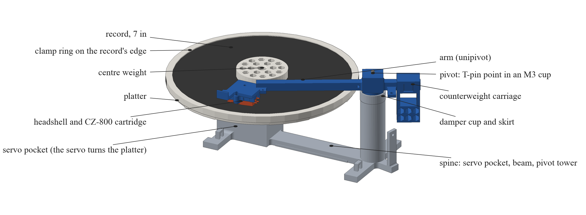
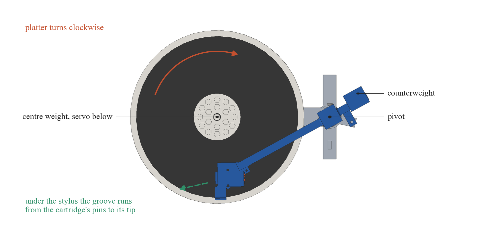
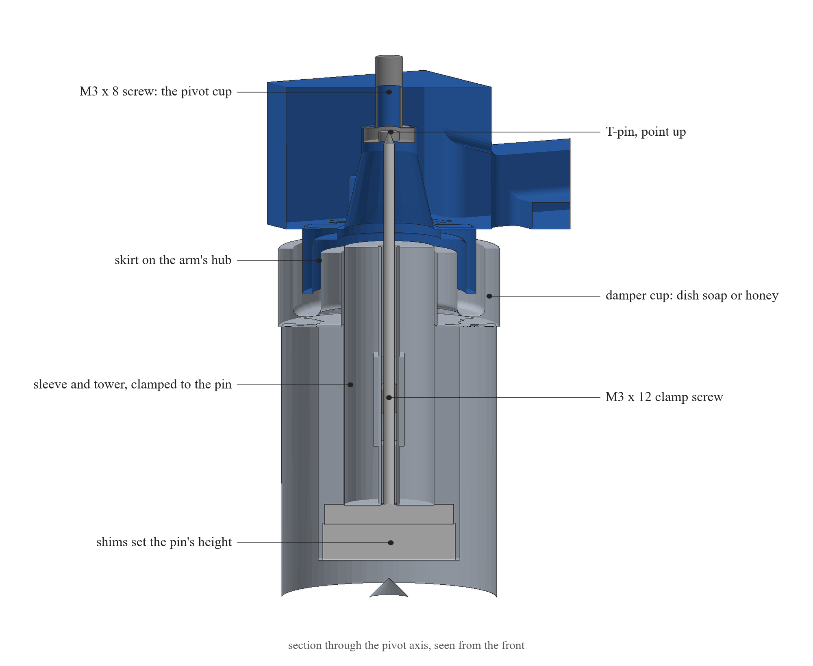

# Building the spine turntable

The spine build is the smallest turntable that plays these records: a servo turns the platter directly, a printed unipivot arm carries a ceramic cartridge, and an Arduino records it. Every printed part is in `hardware/turntable/cad/stl_spine/`, laid out as Bambu Studio plates in `hardware/turntable/print/spine/`. The largest part is 195 mm, so it fits a 200 mm bed.

These plates are the revised design (Nov 24 2026): the pin is clamped so the pivot has no play, a skirt in a cup of liquid damps the arm's roll, the counterweight holds nuts in fixed holes, ribs grip the servo, and a ring clamps the disc's edge. The prototype that played was the earlier revision of the same parts. The revision is fit-checked in CAD but has not yet been built as a whole, so print the fit-test plate first.



The figures here are rendered from the CAD (`hardware/turntable/cad/build_figures.py`), not photographed.

## Arm side

The platter turns clockwise seen from above, because that is the only way the spiral plays forwards; don't reverse the motor, the song would play backwards. The groove must run under the stylus from the cartridge's pins toward its tip, so the arm swings over the record on one particular side of the line from the pivot to the spindle. The first prototype's arm was drawn for the other side:

| Setup | Cartridge off the groove | Disc under the stylus |
|:--|:--|:--|
| First drawing | 0.7° | runs from stylus to pins: drags the needle backwards into its mount |
| Same arm, on the side where the drag is correct | 56-57° | pins to stylus: correct |
| Mirrored arm (these files, since Nov 25 2026) | 0.7° | pins to stylus: correct |

The prototype ran in the second row, and 9 of 13 landings thumped and carried little or none of the song. Turned round on its mount, every landing followed the song. The CAD now draws the third row: `turntable.ARM_SIDE = -1` mirrors the arm, its pad, tie and drop tabs and the counterweight carriage, and `spine.py` checks the drag direction every time it builds.

 The headshell, damper skirt and cartridge are symmetric, so they are the same either way.

## Parts

| Part | Notes |
|:--|:--|
| Feetech STS3215 servo, 12 V version, with its horn and screws | Drives the platter directly. Any bus adapter that lerobot's Feetech driver talks to, and a 12 V supply |
| Arduino UNO (or clone) and two 1 MΩ resistors | The recorder |
| Ceramic cartridge, CZ-800 type | The CAD is built around a CKANDAY "universal" CZ-800 clone (snap-in body, no screw holes), measured in `cad/cartridge.py`. Another body needs a new headshell |
| Sewing T-pin, 1.1-1.2 mm wire, about 44 mm long | The pivot point. Used whole |
| M3 × 8 button head | Pivot cup in the arm's hub |
| M3 × 12 button head | Clamps the pin and sleeve |
| 2 × M2 × 12 button head, 2 × M2 nut | Headshell to arm |
| M3 acorn nuts, about 25 | About 7 in the counterweight (weigh yours), up to 18 in the centre weight |
| 1.75 mm filament | A 16 mm length (headshell alignment dowel) and two 6 mm lengths (damper skirt dowels) |
| Dish soap or honey | Fills the damper cup |

## Print

PLA, 0.20 mm layers, no supports; every part is already in print orientation. The plates use 3 walls and 15 % gyroid, 5 shells on the platter and 4 walls with 40 % gyroid on the arm plate. Small holes are drawn oversize for a 0.4 mm nozzle (free fits 0.3 mm over, horizontal holes 0.4 mm, self-tapping pilots 0.2 mm).

1. `plate_9_fit_test.3mf` (1.1 h): coupons cut from the real parts. Check each fit before printing the rest:

| Coupon | Test |
|:--|:--|
| tower top + lower sleeve | drop the sleeve in, the T-pin through it, turn the M3 × 12 onto the pin: no play |
| servo frame | press the servo in from above: firm by hand, no rocking |
| arm hub | the M3 × 8 head drives into its counterbore; two filament dowels push into the skirt's holes |
| stub + carriage | the carriage slides on the stub and holds; an acorn nut pushes into a hex hole and stays |
| rim arc + ring arc | on a scrap of 1 mm disc, the lug drops through the notch and pinches under the ledge |
| weight coupon | the bore slips over the spindle; an acorn nut stays in its pocket |
| damper cup and skirt | the cup slides over the sleeve coupon; the skirt sits on the hub's dowels |

2. `plate_8_clamp_damper.3mf` (1.0 h): clamp ring, centre weight, damper cup, hub skirt.
3. `plate_2_platter_open.3mf` (1.4 h): the platter.
4. `plate_3_arm_small.3mf` (1.3 h): arm, counterweight carriage, sleeve, spindle, shims, headshell.
5. `plate_1_spine.3mf` (1.5 h): the spine (servo pocket, beam and pivot tower in one part).
6. `plate_6_spindles.3mf` (0.6 h): keyed spindles from 6.85 to 7.25 mm. Keep the one that slides snugly into your disc's hole.

`plate_7_headshell.3mf`, `plate_4_sleeve.3mf` and `plate_5_fit_reprint.3mf` are single reprints. On another slicer, use the STLs with the same settings; `docs/ADAPTING_YOUR_PRINTER.md` has more.

## Assemble

1. **Spindle.** After the horn screws are in, drop the keyed spindle into the platter's hub from the top, its cross into the four screw-slot counterbores. It rests on the screw heads.
2. **Pivot.** Screw the M3 × 8 head-down into the arm's hub with a 2 mm key until the head bottoms. Drop the 4 mm shim into the tower slot, then the T-pin point-up with its bar down the slot. Slide the sleeve over the pin with its slot facing the screw hole. Turn the M3 × 12 in through the spot face until it stops on the pin, then a quarter turn more: pin and sleeve should not move at all.

   

3. **Servo.** Plug the cable into the servo's underside, then press the servo into its pocket from above. The ribs hold it; no glue. Screw the platter to the horn with the four M3 × 6 from the servo's bag.
4. **Cartridge.** Press an M2 nut into the hex trap at the foot of each headshell boss. Lay the 16 mm filament dowel in the groove under the arm's pad, set the headshell on it, and bolt it with the two M2 × 12; the dowel sets the angle, the bolts only clamp. Push the cartridge up into the headshell, stylus forward and the tab at the back in its slot, until it stops.
5. **Wiring.** Seen from behind, the cartridge's four pins are L+ upper left, R+ upper right, and the two grounds the lower, closer pair. Join L+ and R+ (a mono lateral groove gives both channels the same signal). Run the leads through the beam's tunnel and out by the hub. Keep them short and twisted: mains hum is the largest noise at rest.
6. **Damper.** Slide the cup over the sleeve onto the tower top. Push the two 6 mm dowels into the hub's underside and press the skirt onto them. Fill the cup about 6 mm deep with dish soap (or 4-5 mm with honey). Lower the arm onto the pin: the skirt drops into the cup.
7. **Balance.** Put the carriage on the stub at its end. Push acorn nuts into the low row first until the stylus force reads 5 g, then slide nuts along their holes until the headshell sits parallel to the record. The counterweight must hang on the side away from the cartridge: put on backwards, it lets the arm roll and the stylus walks out of the groove.
8. **Record.** Put the disc on the spindle, drop the ring on through its six notches and turn it clockwise until snug. Drop the centre weight over the spindle. Tape the spine to the desk.

## Wire the recorder

```
5V  --[1 MOhm]--+--[1 MOhm]-- GND      biases A0 at 2.5 V
                |
                A0 ---- cartridge L+ and R+
GND ------------------- cartridge grounds
```

Upload `hardware/turntable/adc_capture/adc_capture.ino` to the UNO. It samples A0 at 9615 Hz and streams over USB at 500000 baud. A ceramic cartridge needs no preamp.

## Play and record

```
pip install pyserial "lerobot[feetech]"     # lerobot 0.7 was used; sounddevice too, for listen.py
python hardware/turntable/spin.py COM7 4 --seconds 65          # servo port, motor id
python hardware/turntable/adc_capture/capture.py COM15 60 take1.wav
```

Run them in two terminals: the servo adapter and the UNO are separate USB devices. `spin.py` prints the measured speed every 2 s; the prototype ran at 39.85 RPM for 40 commanded. `listen.py` records the same files and plays a cleaned copy live (`listen_plus.py` adds an equaliser and silences the gaps between songs).

Lower the stylus gently onto the lead-in. One pass of a song disc is about 32 s.

## Print a disc

```
python hardware/turntable/test_disc/make_test_disc.py
python hardware/turntable/test_disc/make_song_disc.py SONG.wav --start 12 --name mysong
```

Print the test disc first. On a Bambu P1S (0.4 mm nozzle, PLA), `hardware/turntable/test_disc/test_disc_7in_40rpm_p1s.gcode.3mf` is the test disc that played on the prototype (Nov 22 2026), ready to print with no Python or slicer. `analyze_test_disc.py TAKE.wav` reports speed, wow, each tone against its predicted level, where tracking stops and the noise floor. The scripts slice the blank with Bambu Studio's command line; on any other setup, slice `printers/disc7_blank.stl` yourself and set `OV_BASE_GCODE` (see `docs/ADAPTING_YOUR_PRINTER.md`).

On a Bambu printer, copy the `.gcode.3mf` to the microSD card and start it from the printer's own screen. Bambu Studio re-slices any `.gcode.3mf` it opens and drops the groove. The base takes about 38 minutes, then the nozzle traces the spiral for 20 to 30 minutes.

Clean a take:

```
PYTHONPATH=src python -m openvinyl.restore TAKE.wav out/song/mysong/mysong.manifest.json -o clean.wav
```

It notches hum, fills clicks, takes the speed wobble out using the disc's 75 Hz pilot tone, and band-limits to the music.

## Tracking

- What the stylus followed on the test disc: about 9° of groove slope and 90 m/s² of sideways acceleration. The song encoder holds music under 7° and 70 m/s².
- One wall layer per bead landed better than two (5 of 11 full landings against 1 of 6), so the song script prints one.
- More tracking force helped the first song disc track. If it skips, add a nut.
- PLA discs warp edges-up; the clamp ring and centre weight hold them flat.
